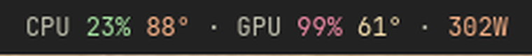

# Pastel Stats

An [Omarchy](https://omarchy.org/) bar widget that shows CPU and GPU usage, temperatures, and total power draw, color-coded in pastels so you can tell at a glance when something is working hard.



## Features

- CPU usage, temperature, and package power
- GPU usage, temperature, and power for NVIDIA and AMD cards
- Combined CPU + GPU wattage
- Each number shifts from green to yellow to peach to pink-red as it climbs
- Anything your hardware can't report is left out instead of showing zeros
- Hover for a per-device breakdown, click to open btop

## Install

```bash
omarchy plugin add https://github.com/michaelsucks/PastelStats --enable
```

## Remove

```bash
omarchy plugin remove io.github.michaelsucks.pastel-stats
```

This takes the widget off the bar and deletes the plugin folder. The plugin only reads from `/proc` and `/sys` and never changes your system or other config.

## Colors

| | Green | Yellow | Peach | Pink-red |
|---|---|---|---|---|
| Usage % | under 50 | 50+ | 80+ | 90+ |
| CPU temp | under 70° | 70+ | 85+ | 95+ |
| GPU temp | under 60° | 60+ | 75+ | 83+ |
| Total watts | under 150 | 150+ | 300+ | 450+ |

Temperature thresholds can be changed on the widget's entry in `~/.config/omarchy/shell.json`:

```json
{
  "id": "io.github.michaelsucks.pastel-stats",
  "interval": 2,
  "cpuTempWarm": 70,
  "cpuTempHot": 85,
  "cpuTempCritical": 95,
  "gpuTempWarm": 60,
  "gpuTempHot": 75,
  "gpuTempCritical": 83
}
```

`interval` is how often the stats refresh, in seconds.

## Hardware support

| | Source |
|---|---|
| CPU usage | `/proc/stat` |
| CPU temp | `k10temp` or `zenpower` (AMD), `coretemp` package sensor (Intel) |
| CPU power | RAPL package energy (`/sys/class/powercap/intel-rapl:0`), works on both AMD and Intel |
| NVIDIA GPU | `nvidia-smi` (ships with the NVIDIA driver) |
| AMD GPU | `amdgpu` sysfs; the card with the most VRAM is used, so a discrete GPU wins over an iGPU |

NVIDIA is used when `nvidia-smi` finds a card, otherwise AMD. To force one, set `PASTEL_STATS_GPU=nvidia` or `PASTEL_STATS_GPU=amd` in the shell's environment.

Intel GPUs are not supported yet, since their usage counters need root. The GPU section is simply hidden.

### CPU wattage

Most kernels only let root read RAPL energy counters, so CPU watts are hidden by default and the total shows GPU power only. To show CPU power, add a udev rule that makes the counter readable:

```bash
echo 'ACTION=="add", SUBSYSTEM=="powercap", KERNEL=="intel-rapl:*", RUN+="/usr/bin/chmod 0444 /sys%p/energy_uj"' \
  | sudo tee /etc/udev/rules.d/90-rapl-energy.rules
sudo udevadm trigger --subsystem-match=powercap --action=add
```

Kernels restrict this counter by default because fine-grained power readings have been used in side-channel attacks ([PLATYPUS](https://platypusattack.com/)). Only add the rule on a machine you trust everyone with a login on.

## Requirements

- Omarchy with the Quickshell-based Omarchy shell
- A horizontal (top or bottom) bar; the widget hides itself on vertical bars
- `nvidia-smi` for NVIDIA GPU stats

## License

MIT
